# Open Rash

> **Please note:** this project is provided as is, and I'm unlikely to fix reported issues. You're welcome to fork it and make your own fixes. Some problems turned out to be hard to fix: the textures wobble with the original renderer's draw-distance
> handling, and fixing that properly would mean rebuilding the 3D world from scratch, which brings its own set of challenges.
> My own plans will probably continue in a fork focused on the True 3D mode, better upscaled art, a day / night cycle, weather effects and more.
>
> The widescreen art mod (the menu side strips and upscaled sprites, textures and skies) is not included yet; I'll work out how to share it later.

Open Rash does not include the game's content (graphics, sounds, music, videos, courses). You need your own copy of *Road Rash* for Windows 95;

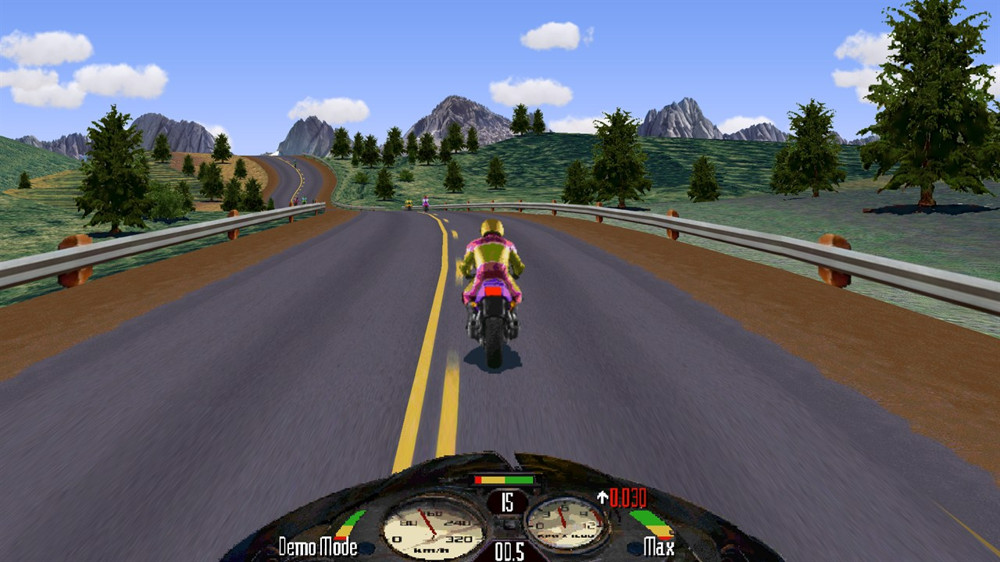

## Features

### Hardware renderer (GPU)
The race world is drawn by the graphics card (Direct3D 11) at your window's own resolution, with smooth, perspective-correct textures.
The **widescreen** race view (the default) gives a wider field of view instead of stretching the picture, and a **course map** can be shown beside it.
With the widescreen art mod installed (see below), Video Options > Upscaled Sprites adds **slightly upscaled** sprites and textures and
**clouds drifting across the sky** (both off by default).

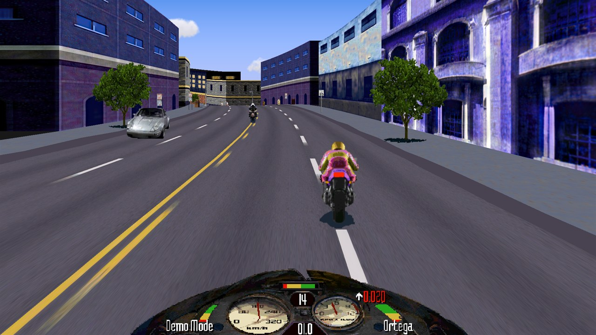

### True 3D (WIP)
An optional real 3D world with a much longer draw distance: the road ahead, the hills and the scenery stay visible far into the distance
(split roads are not shown in this mode). The default, *Pseudo 3D*, redraws the game's own view at high resolution with every road fork intact.
Gameplay never depends on the view: races play out identically in every mode.

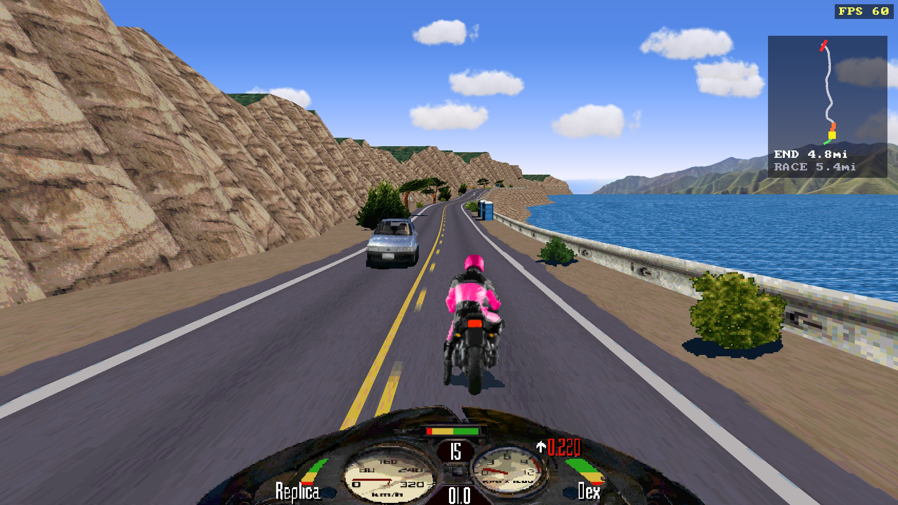

### The original picture, exactly
The **software** renderer reproduces the original 640 x 480 picture pixel for pixel, scaled to your window (sharp or smoothed).

The same moment of a City race in both renderers: the software picture (left) and the GPU's widescreen view with the upscaled sprites and textures (right):

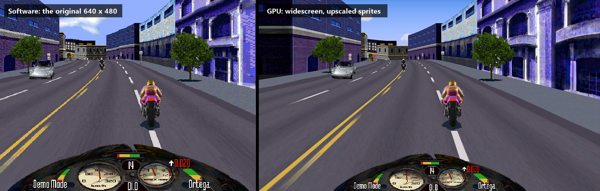

### Widescreen menus
With Menu scaling set to *Widescreen*, the menu and story pictures fill a 16:9 window: each picture gets painted side panels that continue its scene,
instead of black bars. The artwork is an optional mod, distributed separately: copy its `widescreen` folder into a `mod` folder next to `OpenRash.exe`
(`mod\widescreen\`). It also holds the slightly upscaled sprites, textures and skies. Without it, the menus keep black bars and the original art is used.

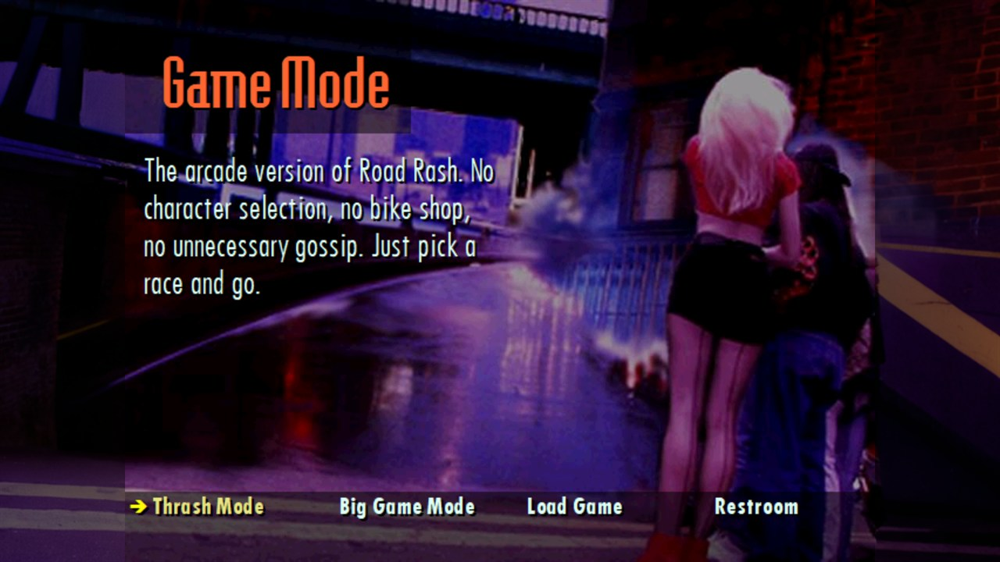

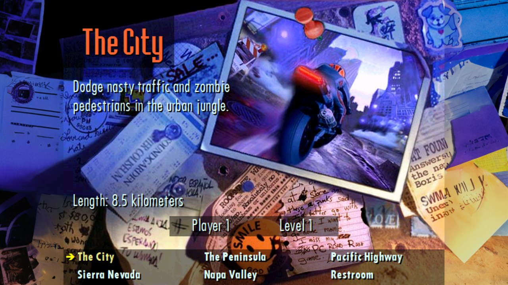

### Video Options
The Restroom's old "Graphics Options" became **Video Options**: window or fullscreen, window size, fullscreen resolution, smoothing, V-Sync,
menu scaling, videos, renderer, Pseudo / True 3D, race view and FPS counter - all saved between sessions.
F11 or Alt+Enter switches between window and fullscreen at any time.

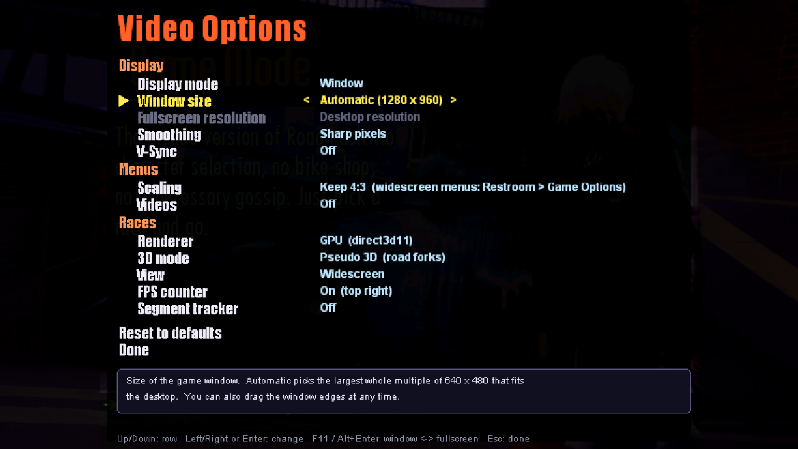

### Game Options
Restroom > **Game Options** switches the widescreen art mod on or off and sets what uses it: widescreen menus, upscaled sprites and moving clouds.
It also has the course map and Change clothes.

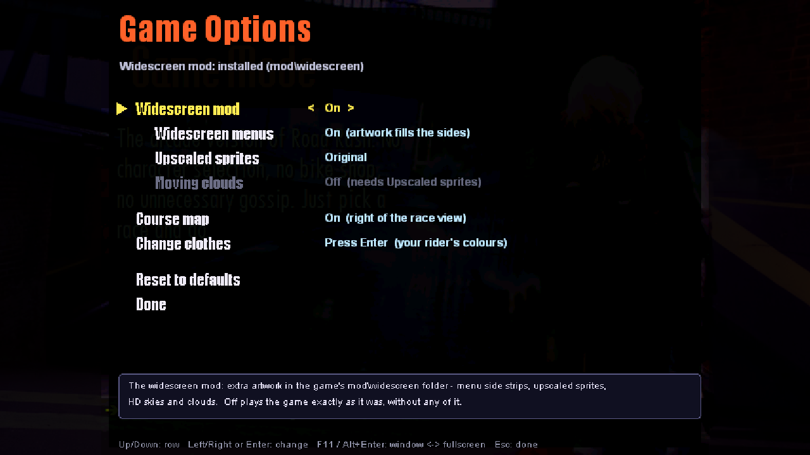

### Rider colours
Restroom > Game Options > Change clothes: recolour your rider's helmet, jacket, stripes, trousers and bike, with a live preview from four sides
(hardware renderer).

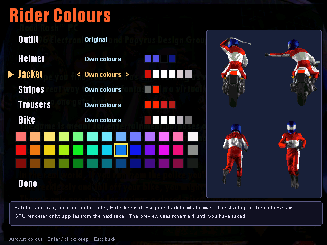

### Music
Restroom > Sound Mix > Music can play the game's licensed **songs** in random order, in menus and races, with a short "Now Playing" title.
The **Jukebox** plays any song on request, and the music videos play again (both need the song / video files of your own copy of the game).

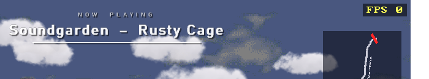

### And also
- Settings live in `RoadRash.cfg` next to the exe
  (an existing Road Rash registry entry is imported once).
- An in-game save / load screen instead of the Windows file box: every save is a tile with the rider, money, level, races, bike and date,
  and the game saves automatically after every race.
- Game controllers work out of the box.

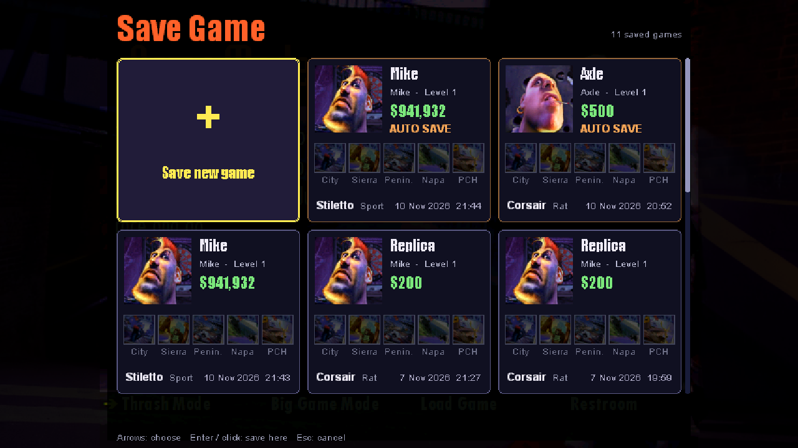

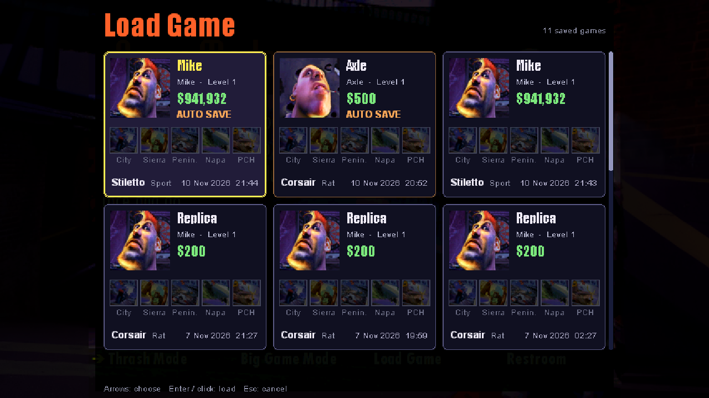

## What you need
- Windows 11.
- To play: your own copy of *Road Rash* for Windows 95, copied into `data\` (`AUDIO\`, `DATA\`, `IMAGES\`, `TEXT\`, ...).
- To build: nothing from the game (see below).

## Building
Prerequisites:
- Visual Studio 2022 Build Tools with the C++ x86 compiler, and the Windows 11 SDK (10.0.26100). Both install paths are set at the top of `scripts\common.ps1`.
- SDL 3.4.20: unpack `SDL3-devel-3.4.20-VC.zip` from the [SDL releases](https://github.com/libsdl-org/SDL/releases) into `deps\`
  (so that `deps\SDL3-3.4.20\include` exists), or point `RR_SDL_DIR` at it.

Then, in PowerShell from the repository folder:

```powershell
scripts\build_quick.ps1     # the game (analysis\build\OpenRash.exe) + ddraw.dll, dsound.dll and SDL3.dll (analysis\build\sdl\)
scripts\run_new.ps1         # play the latest build in a window, with data\ as the working folder
```

More options:

```powershell
scripts\build_inc.ps1                 # quicker rebuild: only the changed source files (-Files a.c,b.c when a header changed)
scripts\build_quick.ps1 -NoShim       # the game only, not the DLLs
scripts\run_new.ps1 -Renderer soft    # force a renderer for this run (gpu | soft); -Track 1..5 goes straight into a race
```

To play from another folder, put `OpenRash.exe`, `ddraw.dll`, `dsound.dll` and `SDL3.dll` together and start the exe with your
game folder as the working directory.

## Repository layout
| Path | What |
|---|---|
| `src/race`, `src/road`, `src/render`, `src/ui`, `src/audio`, `src/assets`, `src/system`, `src/net` | the game in C, by subsystem: riders, AI and physics; road building; drawing; menus and HUD; sound; file and resource loading; start-up, main loop and settings; network |
| `src/data` | the original game's data tables, split by the subsystem that uses them (`data_<folder>.c`) |
| `src/runtime` | own C runtime, entry point, heap |
| `src/resources` | the original game's icons, dialogs, string tables and version information |
| `src/platform` | the SDL3 / Direct3D 11 DirectDraw and DirectSound replacements, and the True 3D world |
| `src/test` | test support |
| `scripts/` | build and run scripts |
| `docs/screenshots/` | the pictures above |

## How the widescreen art mod was made
The mod (`mod\widescreen\`) holds the menu side strips, the slightly upscaled sprites and textures, the traffic cars and the skies.
All of it was generated locally with **[Fooocus](https://github.com/lllyasviel/Fooocus) 2.5.0** (SDXL, its default checkpoint `juggernautXL_v8Rundiffusion`).
Fooocus ran headless: small Python scripts, run with Fooocus's embedded Python, call its own pipeline modules directly instead of the web UI.

Every picture starts from the game's own picture, never from scratch, and is colour-matched back to it so it still looks like Road Rash.
It was made on an RTX 3080 with 10 GB: run one SDXL process at a time, because two thrash.
The scripts are in the author's local `analysis\` folder, which is not in this repository (named below).
This section gives the settings needed to redo or extend the art without them.

### What the game loads
| File | What | Rules |
|---|---|---|
| `Images\<path of the .RRI>.png` | menu side strips | 854 x 480 RGBA. Columns 0-106 = left strip, 747-853 = right strip, the middle 640 columns transparent (the game draws its own picture there). Either side may be empty. |
| `hd\t<track>\<NAME>.png` | course sprites and textures, track 1-5 (1 City, 2 Sierra Nevada, 3 Peninsula, 4 Napa Valley, 5 Pacific Highway) | exactly **4x** the original texture, RGBA, alpha = the original's transparent colour (index 0); any other size is ignored. `<NAME>` = the texture's 8-character name. |
| `hd\t<track>\hashes.txt` | which original each picture belongs to | `<file> <hash>` per picture; hash = FNV-1a 32 of the original texture's palette indices (w x h bytes, row by row). When one track has two different textures with the same name, the files are `<NAME>@<set>.png` and the hash picks the right one. A name listed here whose hash matches nothing is not replaced, so **add a line for every new picture**. |
| `hd\cars\<CARFILE>\<NAME>.png` | traffic cars, by car file: City = CITY, Sierra Nevada = HIWAY, Peninsula = MEDLY, Napa Valley = NAPA, Pacific Highway = CANYN | as for `hd\t<track>` (4x, RGBA, with `hashes.txt`) |
| `hd\horizons\<NAME>.png` | sky panoramas CITY, SIERRA, PENIN, NAPA, PCH | any size; the game uses 2880 x 1280 (4x the 720 x 320 original, 2.25 : 1). It wraps round a full turn, so the left and right edges must meet. Sky without clouds (the game draws moving clouds over it). |

Some pictures share strips:
- `Credits.RRI` uses the `Splash` strips.
- The bike shop (`Showroom\*`, `Bikes\*`) uses the `Street` strips.
- The bulletin board / track page is two pictures, so `Postcard.png` has only the left strip and `Postcard\<name>.png` only the right one.
- Character pictures have three moods: `CHARS\<NAME>-N/-F/-H.png`.

The rider and bike sprites are never replaced, because the game recolours them per rider.

### Menu strips (outpainting)
1. **Source:** the game's `Images\*.RRI`, 640 x 480 JPEGs.
2. **Outpaint** 108 px on each side with Fooocus's inpaint engine (v2.6 inpaint head + patch), the same steps as its Inpaint / Outpaint tab:
   - edge padding;
   - mask = the new columns only, so the original pixels stay untouched;
   - denoise 1.0, 30 steps, CFG 4, sharpness 1-2, sampler `dpmpp_2m_sde_gpu` / `karras`.

   Do one side at a time when the two edges show different things (for example Olley's counter).
3. **Prompt:** describe what continues at that edge, in the picture's style.
   - Template: `continuation of the background: <what is at the edge>, continuing the same scene, same painterly 1990s cartoon video game illustration as the picture, same scale and perspective, <lighting>, soft low detail, slightly blurry`.
   - Negative: `photo, realistic, sharp, highly detailed, text, letters, watermark, frame, border, split screen, extra people, extra faces, deformed`.
   - Keep *soft low detail*: the originals are soft 640 x 480 JPEGs, and sharp strips stand out.
4. **Seeds:** make about 6 and pick the best for each side.
5. **Assemble:** keep the outer 107 columns of each side and write an 854 x 480 RGBA PNG with the middle transparent.
   - Don't recolour or crop the inner edge columns.
   - The game decides which strip belongs to the picture on screen by comparing each strip's inner 2 columns with the picture's edge (brightness in 48 bands of 10 rows). A strip whose edge doesn't continue the picture is not drawn.

### Upscaled sprites and textures (img2img on sprite sheets)
1. **Source:** the course files `world3d\t<n>_l1.rrx`, which the game writes the first time it builds a track's 3D course (True 3D race).
   They hold every texture object (8-character name, size, flags, level-0 palette indices) and the race palette.
2. **Group:**
   - Remove duplicates by name + pixels (1,942 texture objects, 1,085 distinct pictures).
   - Put each *family* (the name without trailing frame digits or a variant letter: walk cycles, tree / building variants) on one canvas, up to 20 items, at least 4 canvas pixels per original pixel. This keeps a family consistent.
   - Give every item 8 px of padding: grey round sprites, mirrored round opaque textures, and wrap-around on axes where the original tiles seamlessly.
3. **img2img** ("Vary" with a set strength): denoise 0.46, 30 steps, CFG 5, sharpness 2, `dpmpp_2m_sde_gpu` / `karras`, seed 3.
4. **Post:**
   - Cut each item back out of its canvas and cross-fade wrap seams using the padding.
   - **Colour match** in CIE Lab: result = AI + (blur(original) - blur(AI)), Gaussian radius 6 output px (1.5 original px). The colours then match the original over every 1.5-pixel area while the detail comes from the AI. Radius 3 brings back the original's dither pattern.
   - Alpha = the original's 1-bit mask, scaled up with a narrow soft ramp.
5. **Exceptions:** use Fooocus's ESRGAN 4x upscaler + the same colour match instead of img2img for:
   - text signs (speed limits, STOP, billboards, street signs), because img2img garbles letters;
   - textures smaller than 8 px;
   - flat road surfaces (lane strips, asphalt), where img2img invents bands and blobs.

### Traffic cars
1. **Source:** decoded from `Data\Cars\*.CAR`.
2. **Generate:**
   - All views of one car family go on ONE canvas in one img2img pass, so all angles show the same car. Side views (`S0` / `X0`) are done alone.
   - Settings as for the textures (denoise 0.46, seed 3).
   - Prompt: `<n> views of the same <colour> 1990s <model>, sprite sheet, identical car in every view`. The model comes from the name: TERCL = Toyota Tercel, GOLF = VW Golf Mk2, VETTE = Corvette C4, PORCH = Porsche 911, PICKP = Chevrolet C/K, VAN = Plymouth Voyager. The colour word comes from the picture's main hue.
   - Negative: `text, letters, lettering, logo, watermark, badge, emblem, number plate text`.
3. **Post:** the same Lab colour match and original mask.
4. **Reuse:** families that are pixel-identical on several tracks are generated once (54 families, 33 passes).

Higher denoise looks more like a real car but starts to change it: at 0.65 the Tercel became a later model.

### Skies
1. **Source:** `Images\Horizons\<NAME>.BOB` (720 x 320). Paint the clouds out first.
2. **txt2img** at 1536 x 640, guided by Fooocus's PyraCanny image prompt on the cloud-free original's edges (seeds 3 and 5; pick one).
   - The prompt describes the scene and ends with `clear cloudless pale blue sky, summer afternoon`.
3. **Seam pass:** a second pass over the left / right join so the panorama wraps.
4. **Post:**
   - Stretch to 2880 x 1280.
   - Colour match the land to the original (Lab, broad areas only).
   - Replace the sky with a smooth gradient fitted to the picture's own sky colours.

### Trying a change
- `RR_WIDE_DIR=<folder>` loads the mod from another folder.
- `RR_HDTEX=1` / `RR_HDSKY=1` force the upscaled textures / sky on; `RR_WIDE=off` turns the whole mod off.
- The upscaled sprites, textures and skies are drawn only by the GPU renderer.
- A picture with the wrong size is skipped and logged.

### Scripts (local `analysis\` folder, not in this repository)
| Part | Scripts |
|---|---|
| Menu strips | `fooocus_outpaint.py` (jobs.json: in, out, pad, side, prompt, negative, seed, steps, cfg, sharpness); job files in `schmooze_strips\`, `olleys_strips\` |
| Sprites / textures | `hd_tex\scripts\`: `extract.py`, `hd.py plan` / `post`, `hd_runner.py`, `fix_roads.py`, `hashes.py`, `run_all.sh`; notes in `hd_tex\README.md` |
| Cars | `cars_hd\scripts\fooocus_img2img.py`, `cars_hd\final046\build.py`, `cars_hd\consistency\fooocus_cn.py`; notes in `cars_hd\README.md` |
| Skies | `sky_napa\sky.py` (technique trials), `sky_napa\horizons.py` |

## Credits
- **Road Rash** (Windows 95) &copy; 1996 Electronic Arts. *Electronic Arts presents a Buzz Puppet Production in association with Papyrus Design Group, Inc.*
  Road Rash PC is based on Road Rash 3DO, &copy; Electronic Arts 1991-94. Road Rash is a trademark of Electronic Arts.
  All credit for the game - its design, art, sound and the original program - goes to its creators.
- **[SDL](https://www.libsdl.org/)** by Sam Lantinga and the SDL contributors (zlib license) - window, input, audio and rendering.

Open Rash is a non-commercial fan project. It is not affiliated with, endorsed by or connected to Electronic Arts or any of the companies above.

## License
Open Rash's own code is licensed under the [GNU General Public License v3.0](LICENSE): you may use, copy, change and share it, provided that
anything you distribute that is based on it is shared under the same license, with its source code.

The license covers only Open Rash's own work. It grants no rights to *Road Rash* itself, its data, music, videos or trademarks, which remain the
property of their owners.